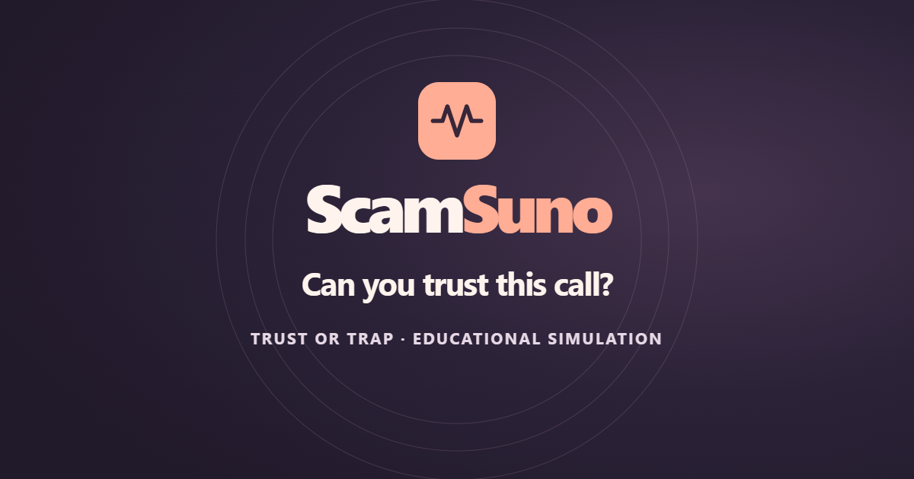
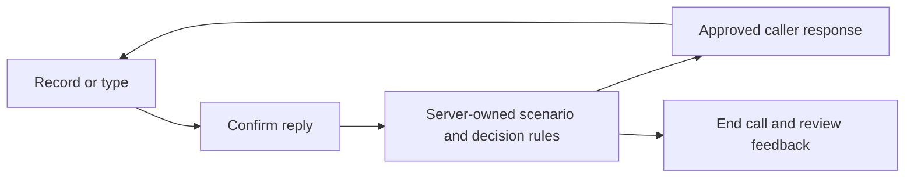

# ScamSuno



**Can you trust this call?** ScamSuno is a multilingual voice simulator for practising how to respond to suspicious calls. Trust or Trap presents a fictional caller, lets you answer in your own words, and explains what your choices showed after you end the call.

[Open Trust or Trap](https://scamsuno.vercel.app) · [Open Classic scripted practice](https://scamsuno-classic.vercel.app) · [Watch the 60-second demo draft](brag-output/scamsuno-v3-draft.mp4)

## Try Trust or Trap

1. Choose **English**, **தமிழ் (Tamil)**, **తెలుగు (Telugu)** or **हिन्दी (Hindi)**. English is the default.
2. Answer the fictional call. Listen or read the caption, then speak or type a reply. With voice, review the transcript before you send it.
3. Check the caller's claim in the simulated trusted channel if you choose. The check evaluates the notice. The caller's identity remains unverified.
4. Tap **End Call** for the debrief. It reveals the scenario and explains the observed decisions. Behaviours the call did not test are marked accordingly.

The scenarios include legitimate, fraudulent and ambiguous calls. Use fictional details throughout. Live voice availability depends on a time-limited provider allowance. Classic runs separately with scripted replies and shipped caller audio. [Rollout and verification](docs/release/PUBLIC_VOICE_ROLLOUT.md)

## How it works



Gnani **Prisma** transcribes audio and **Timbre** speaks the caller's lines. The hosted text model ranks scenario-approved replies and helps interpret decisions. The server validates those decisions and owns the scenario, independent check and debrief. Calls run in turns so you can review what was heard before the caller responds. The app uses Next.js, React, TypeScript and a durable libSQL ledger.

ScamSuno sends recordings to Gnani for transcription. It keeps audio in memory and omits participant reply text from new V3 session records. The current filtered reply can go to the hosted model. Session ownership protects the debrief, and the provider ledger caps attempts and concurrency. [Scenario design](docs/V3_SCENARIO_DESIGN.md) · [Evaluation rubric](docs/V3_EVALUATION_RUBRIC.md) · [Usage ledger](docs/V2_LEDGER_SCHEMA.md)

## Run locally

Install **Node.js 24** and **pnpm 11.25.0**, then start the local server.

```sh
pnpm install --frozen-lockfile
GNANI_MODE=mock CLASSIFIER_MODE=buttons VERCEL_ENV=development pnpm dev
```

In PowerShell, set the variables on separate lines.

```powershell
$env:GNANI_MODE = 'mock'
$env:CLASSIFIER_MODE = 'buttons'
$env:VERCEL_ENV = 'development'
pnpm dev
```

Open the local home page to try scripted practice. To see a full V3 call without credentials, install Chromium as described below and run `pnpm test:e2e --headed tests/browser/v3.spec.ts`. Playwright supplies the labelled test responses. [Local home page](http://127.0.0.1:3000)

## Verify a change

```sh
pnpm verify
pnpm check:audio
pnpm exec playwright install chromium
pnpm test:e2e
```

`pnpm verify` runs the type check, unit and route tests, and a production build. Browser tests use labelled fixtures and generated microphone input. Set `PLAYWRIGHT_CHROME` to use a local Chrome executable. On Linux CI, install Chromium's system dependencies with `pnpm exec playwright install --with-deps chromium`. [GitHub Actions](https://github.com/peeta-devaraj/ScamSuno/actions)

## Release and demo

GitHub holds the source and runs verification. Vercel production promotion is a separate operator step. Keep provider credentials in ignored local files or the target project's server environment, with separate Preview and Production ledgers. [Environment template](.env.example) · [Release checklist](docs/release/BRAND_RELEASE_CHECKLIST.md) · [Voice runbook](docs/audit/V3_VOICE_LAUNCH_RUNBOOK.md)

The demo draft shows the public site. Its voice, independent check and feedback sequence is illustrated while the Android recording is pending. A production English smoke used synthetic input with real Prisma and Timbre, and the public Tamil and Telugu debrief checks exercised End without microphone input. [Demo status](docs/demo/VIDEO_PRODUCTION_STATUS.md) · [Editable composition](brag-output/composition/) · [Android acceptance checklist](docs/audit/V3_DEVICE_ACCEPTANCE.md)

V1 and V2 remain recoverable from the `v1-stable` and `v2-verified-2026-11-08` tags. The V3 recovery record covers the source, deployment and ledger separately. [V1 recovery](docs/V1_PRESERVATION.md) · [V3 recovery](docs/V3_RECOVERY.md)
