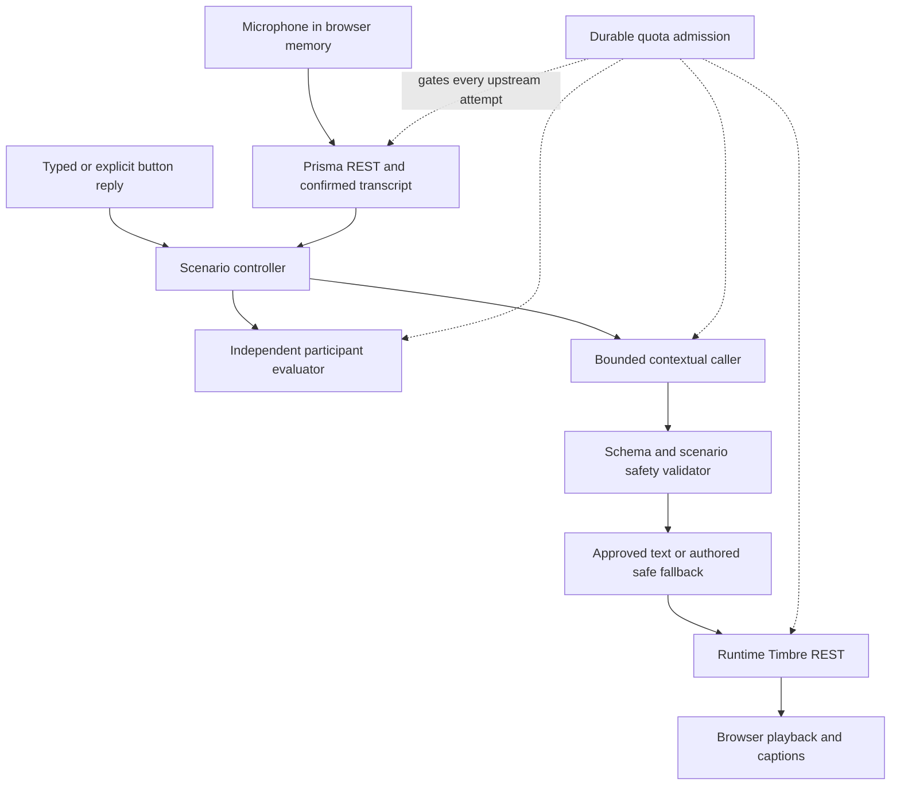

# Dynamic voice architecture

Status: proposed V2 design, November 7, 2026. This document defines the intended boundaries; it does not assert the modules, quotas, live voice loop, or release gates already pass. Provider evidence and unresolved capabilities are in [voice research](REALTIME_VOICE_RESEARCH.md).

## Delivery boundary

Build a dynamic, turn-based loop inside the isolated V2 worktree. Keep the verified V1 source, deployment, environment, and recovery point intact. Use previews for V2. Production promotion requires the user's explicit approval after acceptance and rollback verification.

Tamil and Telugu receive the same complete journey as English and Hindi: selection, recording, transcript confirmation, contextual caller response, audio, captions, typed fallback, results, and safety explanations. Preserve reply origin as `voice`, `typed`, or `button`; fixture execution must be visibly identified. Do not silently replace a selected locale with Hindi or English.

The controller decides transitions and endings. Generated dialogue varies within an authored fictional scenario; the caller cannot invent new objectives, ask for genuine credentials, or execute external actions.

## Separate responsibilities

1. **Scenario controller:** own scenario/version, selected locale, permitted phase, warning cues, allowed objectives, turn/session limits, and termination. Compute legal next actions from confirmed participant input. Ending the call cancels pending work and prevents later responses from advancing state.
2. **Conversational caller:** produce bounded structured output containing only dialogue, its permitted conversational action, and completion information. Supply immutable scenario constraints and a bounded history as distinct inputs. Participant content is untrusted data, never system instructions. The caller does not write scores or authorize provider usage.
3. **Generated-dialogue validator:** check schema, length, locale expectations, allowed action/phase, fictional entities, prohibited links/payment directions/credential collection, and repetition. Validate the whole reply before synthesis. A model's assertion that its reply is safe is insufficient. Reject or replace failures with an authored localized alternative; do not retry generation without a separate budget reservation.
4. **Independent participant evaluator:** consume actual participant evidence, reply origin, and the controller's tested criterion. Validate hosted output against the intent contract, including evidence and uncertainty. Keep caller-generation output out of scoring decisions. A model used for both jobs still requires separate prompts, schemas, and authority boundaries; it does not create independent real-world accuracy evidence.

Quoting a code, discussing digits, and refusing a request must never automatically count as disclosure. If retaining the existing narrow shortcut, apply it only to a whole unquoted code reply during an explicit fictional code-demand phase, after refusal/quotation checks. Unclear recognition or interpretation is unscored. Exclude criteria never exercised from the denominator, and explain evidence for every scored outcome. A simulation result is educational feedback, not a fraud-susceptibility diagnosis.

## Bounded session and operation state

Keep a server-validated envelope containing schema/scenario versions, random session ID, locale, phase, monotonic turn number, reply origins, tested criteria, resolved outcomes, warning cues, and termination status. Store only a fixed maximum of recent, number-masked exchanges for caller context. Cap per-message length and total context size; prefer deterministic truncation before adding summarization. Define limits centrally and test their boundary behavior. Session lifetime and turn limits apply on the server.

Use a unique operation ID and expected turn version to prevent replay and simultaneous state advances. Repeated HTTP delivery must not repeat provider calls. A durable store holds admission/idempotency records and any minimal session coordination needed across invocations. The browser's self-reported score or state is not authoritative. Keep raw audio in memory only; do not retain raw reply text in usage records, request logs, error messages, or share cards.

The browser has one active generation token and operation cancellation signal. End, retry, navigation, or a new turn invalidates old results and stops buffered playback. An aborted request may already have incurred a provider charge; cancellation is not a refund guarantee. Show listening, transcription, generation, and playback states only while those operations are active. Initially use push-to-talk and explicit transcript confirmation; this is not full-duplex voice.

## Durable budget admission

All paid paths, including retries and independently hosted evaluation, pass through server-side admission. A persistent transactional store must atomically reserve allowance, enforce session/day/concurrency limits, and claim an idempotency key before dispatch. Use a separate V2 namespace; a second key on the same Gnani account does not establish a separate credit pool.

Record operation ID, pseudonymous session ID, time, operation/model, duration or text length, attempt count, status, and measured timing. Track `reserved`, `dispatched`, `settled`, and `unknown` outcomes. Release a reservation known not to have dispatched; retain conservative accounting for dispatched timeouts until reconciled. Do not store recordings, credentials, or participant text. Expiring worker leases must not erase uncertain spending.

**Live V2 admission stays closed until a timestamped official balance reconciliation and conservative allowance are configured.** Preserve at least the brief's 1,000-credit reserve for V1. Without a verified billing conversion, enforce hard request/duration/text/session quotas and report credits as unknown, not an invented numeric balance. Also cap actual paid test runs. A local ledger cannot see V1 or dashboard calls automatically; reconciliation must account for them before increasing V2 allowance. Store outages and unreconciled/expired budget configuration fail closed. Secure `/admin/usage` on the server and keep Gnani/LLM expenses distinct.

## Incremental acceptance gates

- **A: fixture integration.** No paid calls. Prove structured output, arbitrary participant input, ta/te/en/hi locale preservation, safe fallback, quotation/refusal handling, source provenance, idempotency, and concurrent durable admission. Fixtures remain visibly labeled and production rejects them.
- **B: bounded live REST loop.** After budget admission opens for a limited allowance, verify real Prisma, contextual LLM, validated runtime Timbre, and several coherent turns. Record actual statuses and stage timings; do not invent transcripts or accuracy/latency figures. Test microphone refusal, playback failure, typed fallback, and End Call.
- **C: progressive playback.** Trial [Timbre SSE](https://docs.gnani.ai/api/TTS/tts-sse) after whole-response validation. Verify fragmented events, ordered decoding, first audible sample, cancellation, and mobile playback before advertising streaming.
- **D: streaming input and interruption.** Add a credential-hiding proxy for [Prisma WebSocket](https://docs.gnani.ai/api/STT/stt-websocket), reconnect/version handling, silence finalization, echo control, and stale-buffer cancellation only if earlier gates are stable. Vercel supports sockets, but its example upgrade adapter remains experimental; validate the deployed runtime, not only local mocks. See the [official Next.js example](https://vercel.com/kb/guide/real-time-chat-websockets).
- **Release:** run `pnpm verify`, `pnpm test:e2e`, and `pnpm check:audio`; verify runtime TTS separately from the static-audio manifest check. Record actual mobile-device coverage and remaining gaps. Recheck V1 accessibility after each major milestone. Verify rollback without changing production, then obtain explicit production-promotion approval.
